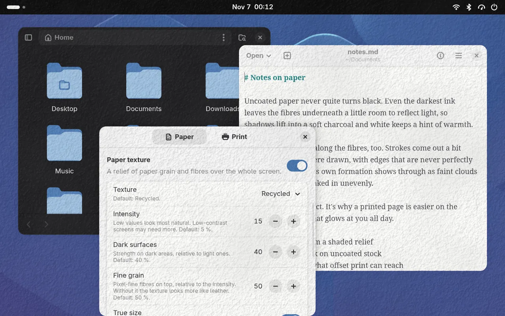

# Paper my Shell

A GNOME Shell extension that lays a paper texture over the whole screen,
so it looks a little more like a printed page and a little less like a
glowing panel.



The compositor draws it on top of everything: every app, the panel, the
lock screen. Nothing animates, so a still screen costs nothing.

## Features

- A paper texture of tooth, fibres and pulp, lit from the upper left.
  Shadows darken light surfaces and highlights lift dark ones, so text
  keeps its contrast. A fine grain on top keeps it from looking like
  leather.
- Seven papers: recycled, drawing, watercolor, washi, laid paper,
  cardboard and canvas.
- The grain keeps its size in millimetres on every monitor.
- Ink mottle. Dark areas lighten in soft patches where the ink soaked in
  unevenly.
- Print effects, each with its own switch:
  - Matte blacks. Even the darkest ink reflects some light, so shadows
    lift towards charcoal like on uncoated paper. White gets a touch
    warmer.
  - Print colours, limited to what offset print on uncoated paper can
    reach. Blues, violets and bright greens calm down, reds and yellows
    stay, greys don't change.
  - Ink spread. Dark strokes grow a little, with ragged edges and short
    feathers along the fibres.
  - Light scattering. Light that enters the paper next to ink scatters
    under it, so dark strokes get a faint soft halo.
- A brightness setting to dim the whole screen.
- Monitors showing a fullscreen window drop the overlay, so games and
  videos keep direct scanout (can be turned off). The texture starts at a
  random spot at every login and unlock, so it doesn't wear into an OLED.

Most effects are subtle on purpose and move dark and light areas by only
a few levels. Screens with low contrast, or with blacks or whites cut off
by their settings, may need higher values. Ink spread and light
scattering take more GPU time when big parts of the screen change. Ink
spread looks best at a display scale of 125 % or more; on OLED panels
without plain RGB stripes its ragged edges can look worse.

## Installation

Needs GNOME Shell 51.

Download `paper-my-shell@coffeebowl.shell-extension.zip` from the
[latest release](https://github.com/coffeebowl/paper-my-shell/releases/latest)
and install it:

```sh
gnome-extensions install --force paper-my-shell@coffeebowl.shell-extension.zip
```

Or from source:

```sh
git clone https://github.com/coffeebowl/paper-my-shell.git
cd paper-my-shell
make install
```

Log out and back in (on Wayland the shell can't reload extensions), then
enable it:

```sh
gnome-extensions enable paper-my-shell@coffeebowl
```

The **Paper** toggle in Quick Settings turns it on and off. Everything
else is in the preferences, from the Extensions app or the toggle's menu.

To remove it, uninstall it and delete its texture cache:

```sh
gnome-extensions uninstall paper-my-shell@coffeebowl
rm -r ~/.cache/paper-my-shell@coffeebowl
```

## How it works

Textures are generated on your machine the first time you pick one, in a
separate `gjs` process so the shell never stalls, and cached in
`~/.cache/paper-my-shell@coffeebowl/`. They come out the same everywhere,
and a new version of the generator replaces them.

Each texture is four seamless tiles that the GPU repeats:

- detail (1024²): the relief. Only small features, so the repeats can't
  be spotted.
- tone (512²): slow variations in tone, stretched 8× so they repeat only
  every 4096 px. Read again at a different size, it also shapes the ink
  mottle.
- grain (256²): pixel-fine fibres and grain.
- ink (256²): fibre directions and where the paper takes ink.

Laid paper and canvas are regular patterns with a period of whole
pixels. Scaled by a fraction they would shimmer, so they ignore the
monitor's size in millimetres.

The paper alone is one full-screen quad per monitor with a small shader;
its blend does the multiply and the OVER at once. The print effects need
the finished pixels, so the UI is rendered offscreen and one shader does
them and the paper in a single pass. Each monitor keeps its offscreen
copy, and a frame only repaints the part that changed. Ink spread and
light scattering read neighbouring pixels, so they also repaint a thin
ring around each change one frame later. Monitors in HDR keep the plain
overlay. All settings are shader uniforms, so changing them never
rebuilds anything.

## Development

- `extension/`: the extension as it is packed. `extension.js` has the
  shaders and the overlay, `prefs.js` the preferences, `papergen.js` the
  texture generator, `generate.js` writes its tiles as PNGs.
- `extension/schemas/`: settings, defaults, ranges and the list of
  textures.
- `tools/preview.py`: the shaders in numpy, for previews over a test card
  or a screenshot.
- `tools/printgamut.py`, `tools/printlut.py`: the print gamut and the
  lookup table baked from it.
- `tools/headless/`: runs the extension in an isolated headless GNOME
  Shell.

The Python tools need numpy, Pillow and SciPy; `make venv` puts them in
`.venv`.

### Testing

`tools/headless/run.sh` starts the extension in a headless GNOME Shell
with its own settings and cache, on the real GPU, next to a helper that
takes screenshots, checks partial redraws or measures frame costs:

```sh
tools/headless/run.sh check /tmp/out                     # screenshots
BG='#c04040' tools/headless/run.sh check /tmp/out 1600x1000,1280x800 print-colors-enabled=false
PAPER_SCALE=1.25 tools/headless/run.sh verify /tmp/out 2000x1250
TIMEOUT=400 tools/headless/run.sh perf /tmp/out 3840x2160
```

All effects are on by default; `key=value` arguments change settings for
the run.

`verify` moves a square over a test card in small steps, then saves what
the monitor shows (`partial.png`) and the same after a full repaint
(`full.png`). The two have to match. Screenshots can't show this, since
they render a fresh offscreen copy.

A real monitor reuses older buffers and repaints the damage of the
frames before as well (buffer age); the headless shell doesn't.
`PAPER_EMULATE_AGE=3` makes `perf` feed the effect such areas, rounded
like Mutter does at fractional scales.

### Textures

A texture is a preset in `papergen.js` plus a choice of the `texture` key
in the schema. To look at one without the shell:

```sh
gjs -m extension/generate.js watercolor /tmp/w
.venv/bin/python tools/preview.py /tmp/w -i 0.15 -o /tmp/preview.png
```

`preview.py` matches the compositor to within 1–2 levels.
[docs/texture-research.md](docs/texture-research.md) has notes on making
believable textures and ideas for more materials.

### Print gamut

`tools/print-gamut.png` is the gamut for print colours, made from Fogra's
characterisation data for uncoated paper (FOGRA52, not in the repository;
from [Fogra](https://fogra.org/en/downloads/work-tools/characterisation-data),
whose terms allow free use, or the
[ICC registry](https://registry.color.org/cmyk-registry/fogra52)). The
shader reads `extension/print-lut.png` instead, the whole mapping baked
into a 65³ lookup table by the same code `preview.py` uses:

```sh
make gamut FOGRA=path/to/FOGRA52.txt   # gamut, then the lookup table
make lut                               # only the lookup table
```

## License

Paper my Shell is free software: you can redistribute it and/or modify it
under the terms of the GNU General Public License as published by the Free
Software Foundation, either version 3 of the License, or (at your option)
any later version. See [LICENSE](LICENSE).
